# Diagrama de classes do domínio

As 11 vistas abaixo representam as 25 entidades implementadas em `backend/models`. Uma classe repetida em vistas diferentes continua sendo a mesma entidade. Os atributos mostrados são os principais; o inventário completo está em [modelos.json](modelos.json).

Todas as entidades herdam de `CrudModel` e `db.Model` por herança múltipla. A primeira vista mostra essa estrutura com Usuario e Evento; ela também se aplica às demais entidades. No desenho, SQLAlchemyModel representa `db.Model`, não uma entidade adicional do domínio.

**Legenda UML:** triângulo vazio = herança; losango preenchido = composição (parte dependente do ciclo de vida do todo); losango vazio = agregação (vínculo compartilhado/opcional); seta simples = associação. Cardinalidades indicam quantos registros podem participar de cada vínculo.

As composições consideram as relações `delete-orphan` e/ou chaves estrangeiras com exclusão em cascata. Autoria e origem opcionais com `SET NULL` são vínculos independentes: excluir a conta ou produto não apaga automaticamente a parte mantida por outro evento.

## Propostas de fornecedores

[Fonte Mermaid](diagramas/10-propostas.mmd)

## Planejamento, cronograma e espera

[Fonte Mermaid](diagramas/11-planejamento-fila.mmd)

## Autorizações e dados alimentares

[Fonte Mermaid](diagramas/08-autorizacoes.mmd)

## Preferências e proteção de envios

[Fonte Mermaid](diagramas/09-preferencias-envios.mmd)

## Conta, aceite e recuperação

[Fonte Mermaid](diagramas/07-conta-privacidade.mmd)

## Herança e persistência

[Fonte Mermaid](diagramas/01-heranca.mmd)

## Contas, organização e convidados

[Fonte Mermaid](diagramas/02-organizacao.mmd)

## Itens e tarefas do evento

[Fonte Mermaid](diagramas/03-itens-tarefas.mmd)

## Despesas, fotos e locais

[Fonte Mermaid](diagramas/04-financeiro-galeria.mmd)

## Catálogo legado e favoritos

[Fonte Mermaid](diagramas/05-fornecedores-favoritos.mmd)

## Notificações e histórico

[Fonte Mermaid](diagramas/06-notificacoes-historico.mmd)

## Precisões sobre o modelo

- `responsavel_tipo`/`responsavel_id` de ItemCompartilhado são uma referência lógica validada pelos Services, sem chave estrangeira polimórfica; não foi inventada uma associação ORM no desenho.
- `FavoritoFornecedor.chave` identifica um estabelecimento externo ou legado. Não existe FK direta desse campo para Fornecedor.
- `Notificacao.referencia_id` é uma referência contextual, não uma FK para uma única entidade.
- As entidades Fornecedor e ProdutoFornecedor mantêm o catálogo legado e seus dados relacionais; o cadastro comercial de fornecedor não integra a lista de 40 funcionalidades da interface atual.

## Atualização

Na pasta backend, execute `py scripts/gerar_diagrama.py` (ou python3). O script lê os metadados das Models sem abrir banco e regenera as fontes/inventário. Os SVGs podem ser exportados com Mermaid CLI. Os testes verificam a correspondência do inventário e dos atributos com as Models.
